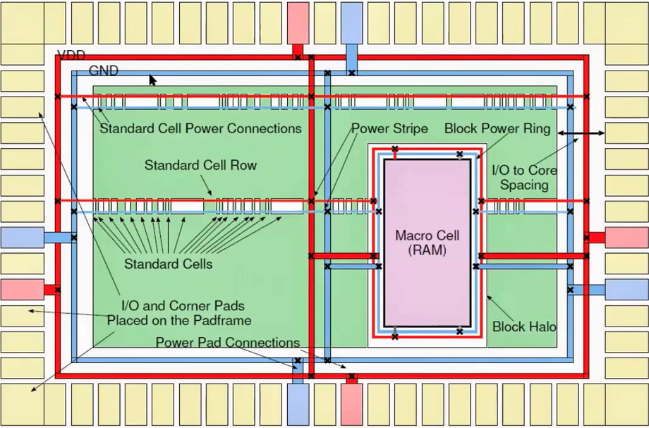
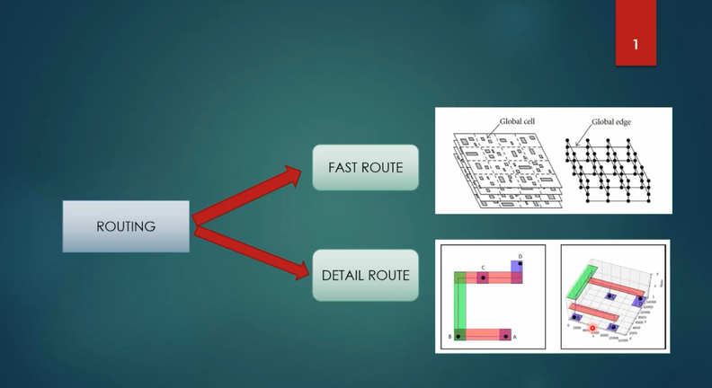
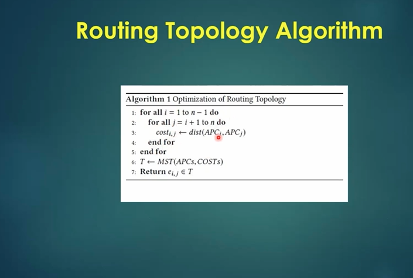
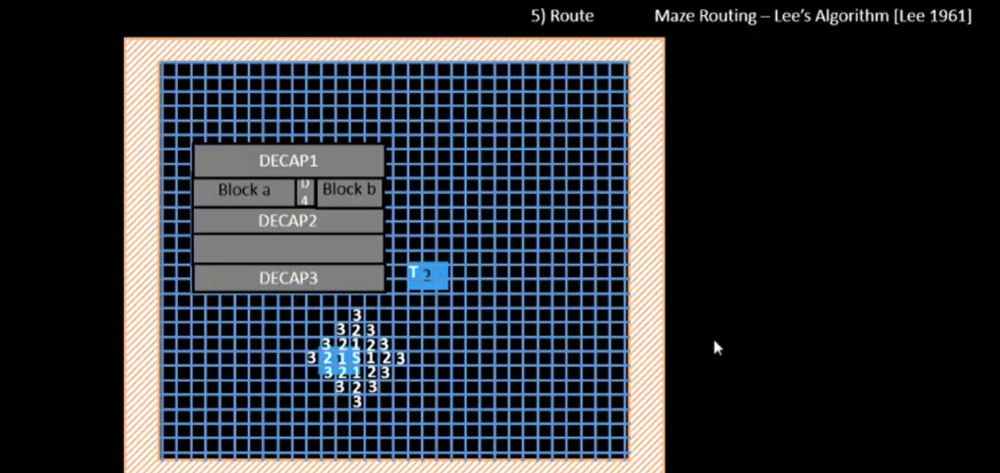
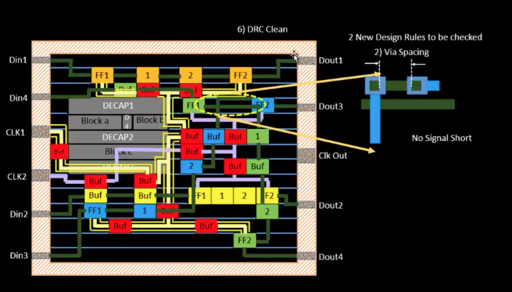
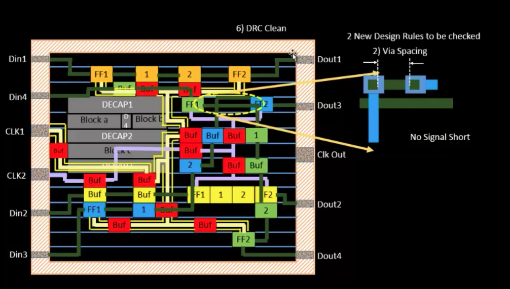

# Day 10 – Physical Design (PD)

This folder documents Physical Design (PD) topics using the supplied workshop images. It focuses on macro-cell floorplanning, routing approaches, routing topology, maze routing, and Design Rule Checking (DRC).

> **Note:** The images are linked from the local `images/` directory. Keep that directory beside this README so the images render correctly on GitHub.

## Contents

- [Macro-cell floorplanning](#1-macro-cell-floorplanning)
- [Routing approaches and RC delay](#2-routing-approaches-and-rc-delay)
- [Routing topology algorithm](#3-routing-topology-algorithm)
- [Maze routing – Lee's algorithm](#4-maze-routing--lees-algorithm)
- [Design Rule Checking (DRC)](#5-design-rule-checking-drc)
- [Summary](#6-summary)
- [References and acknowledgement](#references-and-acknowledgement)

---

## 1. Macro-cell floorplanning

Floorplanning establishes the overall arrangement of the design within the die and core. It considers standard-cell regions, macro/IP placement, power connections, I/O pads, spacing, and routing access.

A macro is a relatively large pre-designed block, such as SRAM, that is placed as a unit. Its position affects congestion, available routing channels, power distribution, and the placement of surrounding standard cells.

The illustration below identifies major floorplanning elements, including the macro region, power rings and straps, standard-cell rows, I/O pads, and spacing around the macro.

### Key points

- Place macros with sufficient routing access and suitable halo/keep-out spacing.
- Consider the power network and connections to the macro and standard cells.
- Leave enough room for I/O access and signal routing.
- Macro placement should be evaluated together with congestion and timing considerations.

## 2. Routing approaches and RC delay

Routing connects placed pins and cells using the available metal layers and vias. Routing is commonly divided into two broad stages:

- **Global routing / fast routing:** estimates routes and allocates routing resources across the design.
- **Detailed routing:** creates the actual geometries and vias while obeying technology design rules.

The supplied slide gives an overview of fast and detailed routing.

### Why RC matters

Interconnects introduce resistance (R) and capacitance (C). These parasitics can increase signal delay and affect transition time. Longer routes, extra vias, and congestion can increase parasitic effects.

After routing, extracted parasitics can be used for more realistic timing analysis than estimates made before detailed routing. The exact delay values depend on the design, routing, libraries, and analysis setup; no numerical delay result is asserted here.

## 3. Routing topology algorithm

A routing topology describes how connections are organized before or during detailed geometric routing. Topology optimization aims to choose a useful connection structure while considering routing cost and constraints.

The supplied slide shows pseudocode for a routing-topology optimization algorithm.

### General idea

1. Consider candidate connection structures.
2. Estimate the cost of each candidate using the chosen routing-cost model.
3. Compare candidate costs and select an improved topology.
4. Pass the selected topology to subsequent routing steps.

The precise algorithm and cost function should be interpreted from the workshop material shown in the image; this README does not claim a particular numerical outcome.

## 4. Maze routing – Lee's algorithm

Maze routing searches for a path between a source and a target on a routing grid. Lee's algorithm is a classic breadth-first search approach:

1. Mark the source grid location.
2. Expand to legal neighboring grid locations in successive wavefronts.
3. Continue until the target is reached or no legal path remains.
4. Trace backward through the wavefront labels to recover a path.
5. Convert the grid path into routing geometry and check constraints.

### Advantages and limitations

**Advantages**
- Finds a shortest path in number of grid steps when all moves have equal cost.
- Systematic and straightforward to understand.

**Limitations**
- Can explore many grid locations and consume memory.
- Real routing must also account for obstacles, layer changes, design rules, congestion, and routing cost.

## 5. Design Rule Checking (DRC)

DRC checks whether the physical layout satisfies the manufacturing rules for the target process. Examples include minimum width, spacing, enclosure, via, and area requirements.

The supplied screenshots are labelled as DRC-clean views. They are included as workshop evidence/illustrations; the exact tool report and rule-deck context are not included in this image set, so no independent verification of a complete sign-off run is claimed.

### DRC result view

### Final DRC view

### Why DRC is important

- Detects layout geometries that violate process rules.
- Helps prevent manufacturing defects caused by invalid widths, spacing, enclosures, or vias.
- DRC cleanliness is one part of physical verification; it does not by itself prove timing closure, LVS correctness, or complete sign-off.

## 6. Summary

This Day 10 PD image set covers:

- Macro-cell floorplanning and the relationship between macros, standard cells, power structures, and I/O.
- Fast/global routing versus detailed routing.
- Routing topology optimization as a way to organize connections.
- Maze routing using Lee's algorithm.
- DRC checks and the importance of validating final layout geometry.

The key takeaway is that physical design is an iterative process: floorplanning influences congestion and routing, routing introduces parasitic effects, and verification checks whether the resulting geometry meets the relevant constraints.

## References and acknowledgement

- [RTL Design Workshop – PD_MODULE_5](https://github.com/afraajabeen-creator/RTL_Design_Workshop/tree/main/PD_MODULE_5)
- [VSD Workshop – Day 10 PD](https://github.com/Ganesh-Koushal/VSD-WorkShop/tree/main/Day%2010%20PD)

This documentation is organized from the images supplied for this repository and is intended as workshop notes. Credit for the workshop material belongs to its original instructors and authors.
