# Day 9 – Timing Analysis, Clock Tree Synthesis and Post-CTS Timing

## Overview

Day 9 explores how timing constraints interact with the physical implementation of a digital design. The notes connect standard-cell delay information with setup and hold requirements, clock distribution, placement, clock skew, and Static Timing Analysis (STA).

The screenshots in this folder document the concepts studied during the session. They are linked from the local `images/` directory so that they render in GitHub when the `README.md` and `images/` folder are kept together.

## Learning sequence

```text
Standard-cell delay information
            ↓
      Setup and hold
            ↓
   Ideal and real clocks
            ↓
 Clock Tree Synthesis (CTS)
            ↓
 Placement and clock network
            ↓
   Post-CTS timing effects
            ↓
 Static Timing Analysis (STA)
            ↓
   Slack and timing checks
```

---

## 1. Standard-cell delay and buffering

Standard-cell timing libraries describe how cells behave under different electrical conditions. Cell delay is influenced by input transition (slew), output load, the selected cell, and the relevant timing arc. A cell driving a larger load or receiving a slower input transition can have different delay and output-slew characteristics.

### Buffer delay examples

The following screenshots illustrate delay information at two buffering levels.

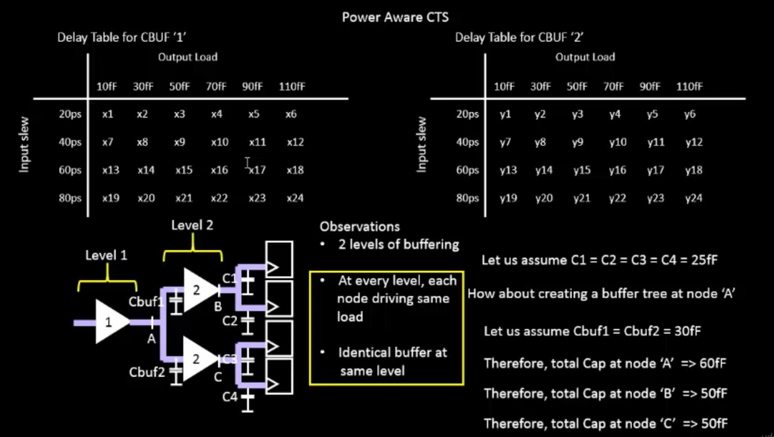

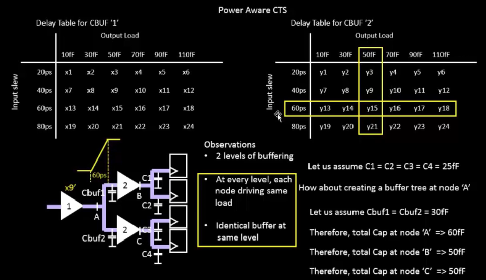

### Delay components

The delay comparison below supports the distinction between the cell's intrinsic behavior and the effects of driving and interconnect conditions.

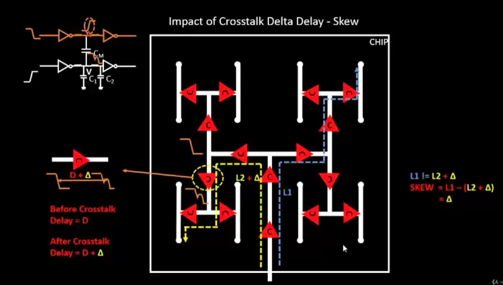

**Key idea:** a path's timing is not determined only by the number of logic gates. Cell choice, transition quality, load capacitance, and the physical net all contribute to the observed path delay.

---

## 2. Setup timing

A setup check ensures that data reaches a capture flip-flop early enough before its active clock edge. If data arrives too late, the receiving flip-flop may not capture the intended value reliably and a setup violation is reported.

A simplified setup relationship is:

\[
T_{cq} + T_{data} + T_{setup} \leq T_{capture\ clock} - T_{launch\ clock} + T_{period}
\]

The exact sign convention and terms in a timing report depend on the clock relationship and analysis setup, but the essential requirement is that data arrive before the capture deadline.

### Setup timing illustration

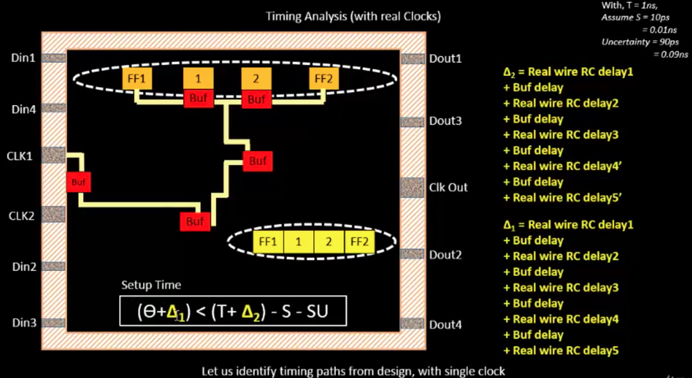

### Ideal-clock setup analysis

An ideal-clock model does not include a physically built clock tree. It is useful for an initial timing view, but does not represent all clock insertion delays and skew introduced by implementation.

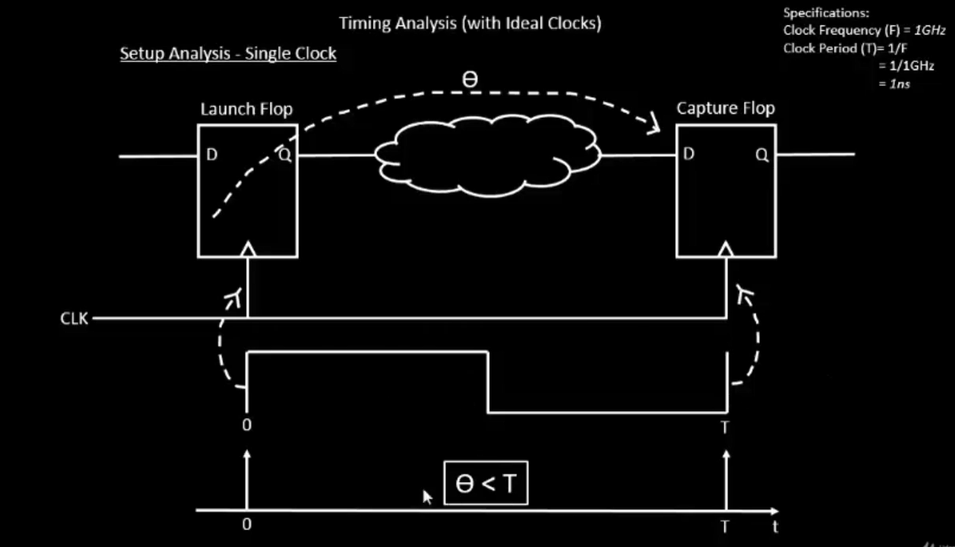

---

## 3. Hold timing

A hold check ensures that data does not change too soon after the active capture-clock edge. Unlike setup, hold analysis is primarily concerned with the minimum delay through the data path and the relative arrival of launch and capture clocks.

A hold violation can occur when the new data reaches the capture register too early. A design can pass setup and still fail hold, so both checks are necessary.

### Hold timing illustration

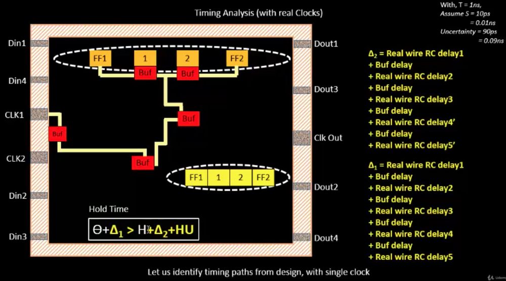

### Hold check with ideal clock

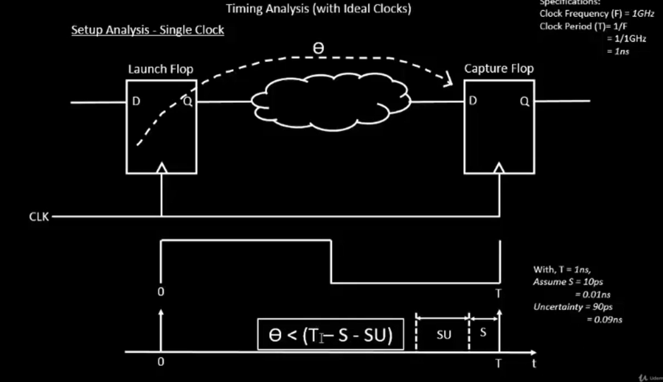

### Hold check with a real clock

After clock-tree implementation, launch and capture clocks can arrive at different times. That clock relationship can change the hold margin compared with an idealized clock model.

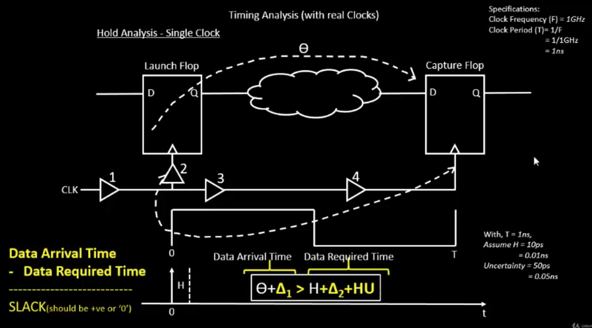

---

## 4. Ideal clock versus implemented clock

An ideal clock is a simplified timing model. A physically implemented clock travels through buffers and interconnect, so it has insertion delay and may reach different sequential elements at different times.

The clock-network implementation introduces effects such as:

- Clock insertion latency
- Clock skew between endpoints
- Buffer delay and transition changes
- Wire resistance and capacitance
- Coupling from nearby signal routes

The real-clock illustration highlights that the clock seen at a sequential cell is affected by the clock-distribution path.

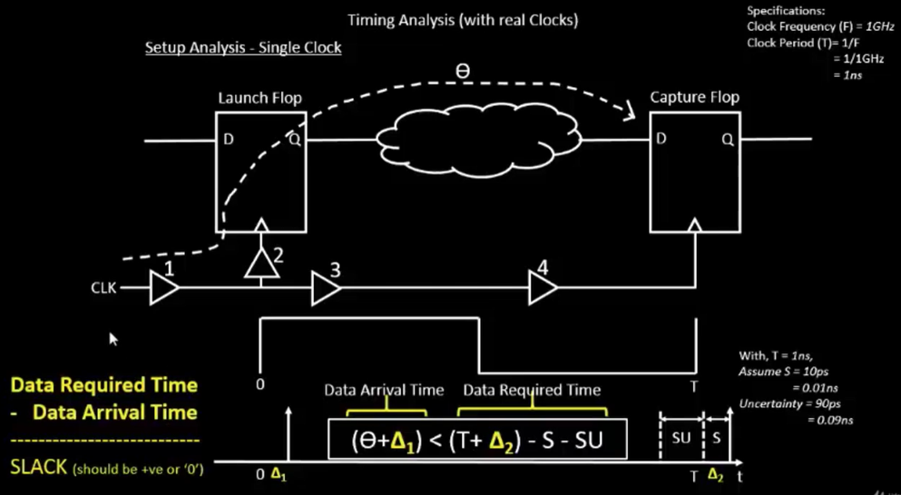

---

## 5. Clock Tree Synthesis (CTS)

Clock Tree Synthesis builds a clock-distribution network to deliver the clock to the design's sequential elements. The network is created with constraints on latency, skew, transition time, capacitance, and physical routing.

CTS is important because clock arrival time is part of the setup and hold equations. A clock network that is logically connected but poorly balanced can cause timing problems.

### H-tree clock distribution

An H-tree is a structured clock-distribution topology that uses repeated branching to aim for similar path lengths to different parts of the design. Actual skew still depends on placement, buffering, loading, and routing.

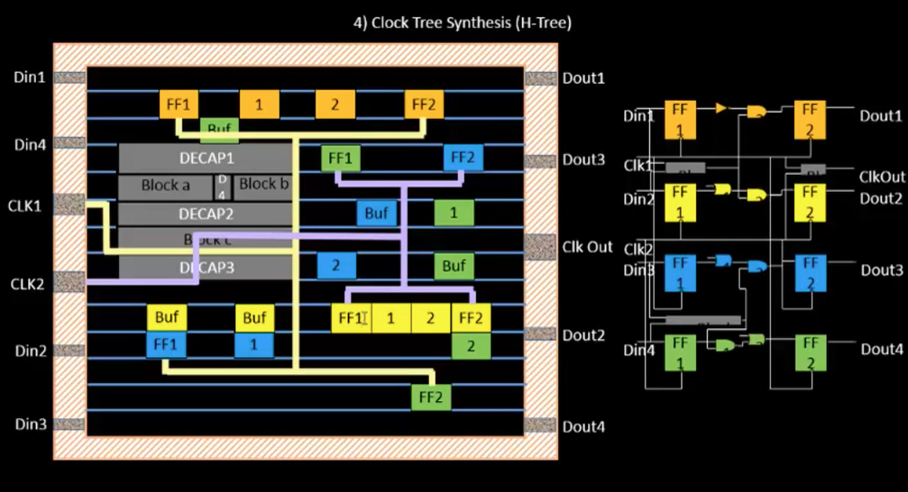

### Clock buffers

Clock buffers provide the drive needed for clock loads and help control signal transition. Buffer selection and insertion affect both clock latency and power.

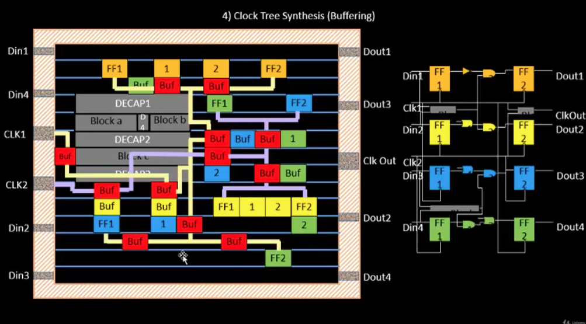

### Clock-net shielding

Shielding places a quiet reference conductor near a sensitive net to reduce capacitive coupling from neighboring switching wires. Whether shielding is used depends on the design rules and routing strategy.

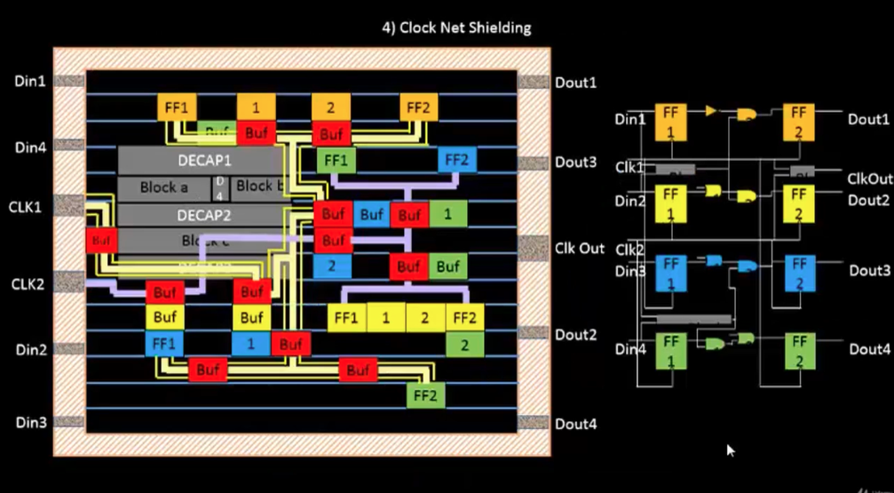

### CTS terminal / network view

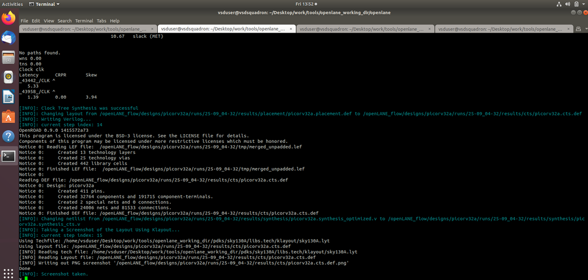

---

## 6. Floorplanning and placement

Physical locations matter for timing. Two cells that are far apart can require longer interconnect, and longer or more complex routes can increase resistance and capacitance. Placement must therefore consider timing alongside congestion, routability, and area.

### Floorplan view

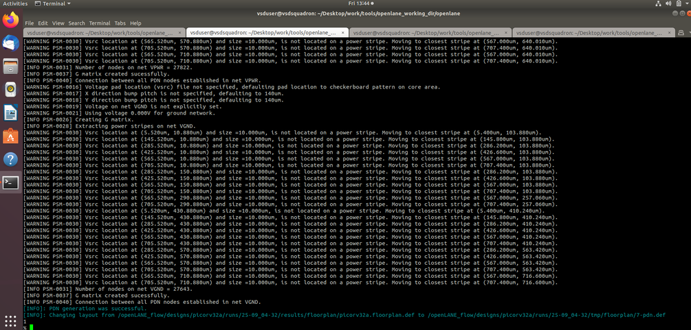

### Placement view

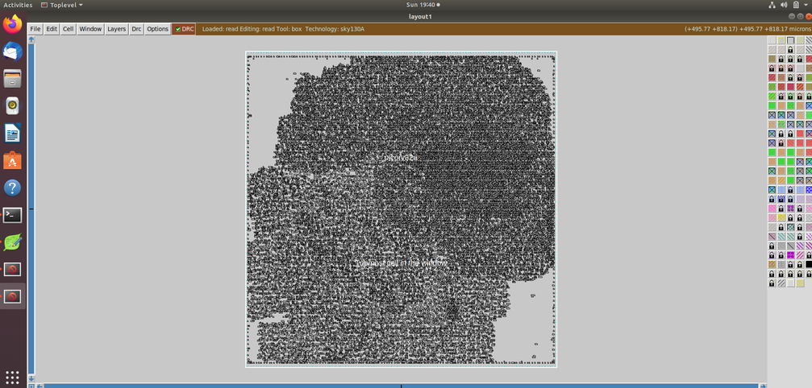

### Placement terminal view

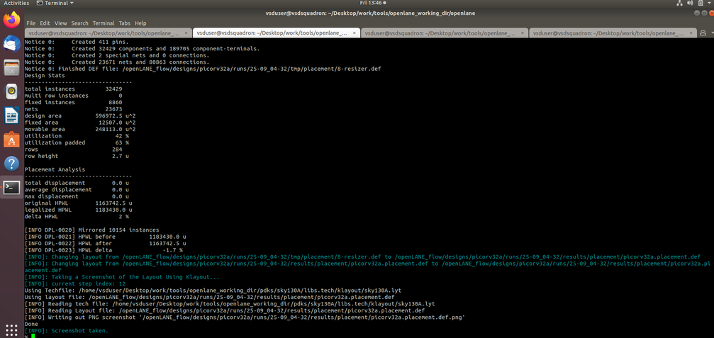

### Expanded placement view

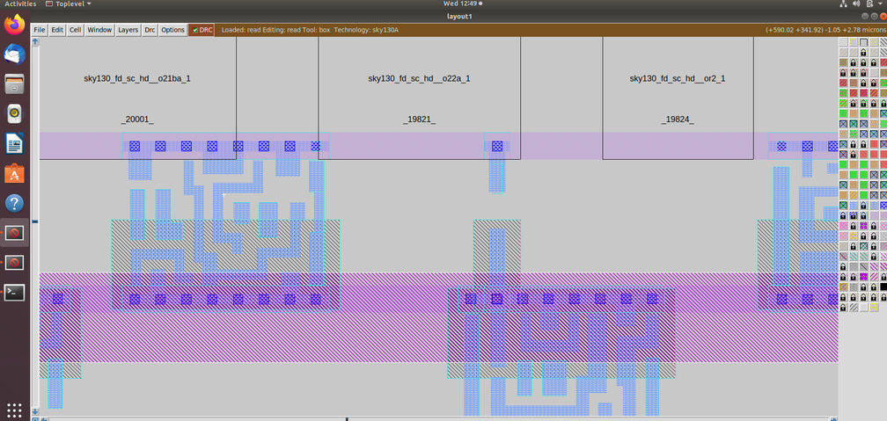

These images illustrate the physical context in which clock and data nets are implemented. The screenshots are visual evidence of the supplied session; they are not used here to claim numerical timing closure or a particular WNS/TNS result.

---

## 7. Clock skew and post-CTS timing

Clock skew is the difference between clock arrival times at two sequential endpoints. Skew can be helpful or harmful depending on the path and timing check, so it must be analyzed rather than assumed to be zero.

For a pair of endpoints, skew can be expressed as the difference between their clock arrival times:

\[
T_{skew} = T_{capture\ clock} - T_{launch\ clock}
\]

The sign matters: capture-clock arrival later than launch-clock arrival affects setup and hold differently from the opposite relationship.

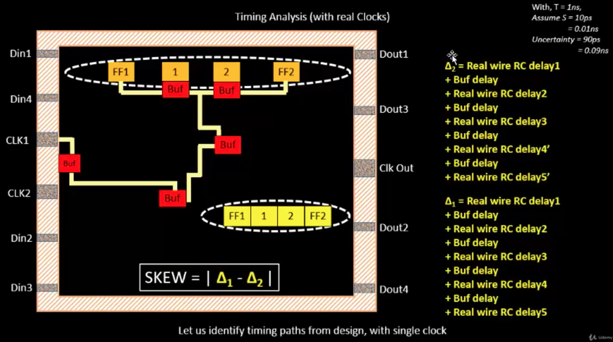

After CTS, timing analysis can use the implemented clock network and, depending on the stage of the flow, estimated or extracted interconnect parasitics. This gives a more realistic picture than an ideal-clock estimate.

---

## 8. Static Timing Analysis (STA)

Static Timing Analysis checks timing paths against constraints without simulating every possible input sequence. It calculates path arrival and required times using cell timing models, clock definitions, constraints, and the delay information available at that stage.

### Common timing quantities

- **Data arrival time:** when data reaches the endpoint.
- **Data required time:** the deadline imposed by the timing requirement.
- **Slack:** the margin between the required time and the arrival time.
- **Setup slack:** indicates whether the maximum-delay requirement is met.
- **Hold slack:** indicates whether the minimum-delay requirement is met.

For setup analysis, a common conceptual expression is:

\[
Slack_{setup} = T_{required} - T_{arrival}
\]

Positive slack indicates margin for the analyzed check; negative slack indicates a violation for that check.

### STA terminal output

The terminal screenshots below are included as evidence from the supplied images. Interpret any numerical result using the actual report context, constraints, corner, and timing stage.

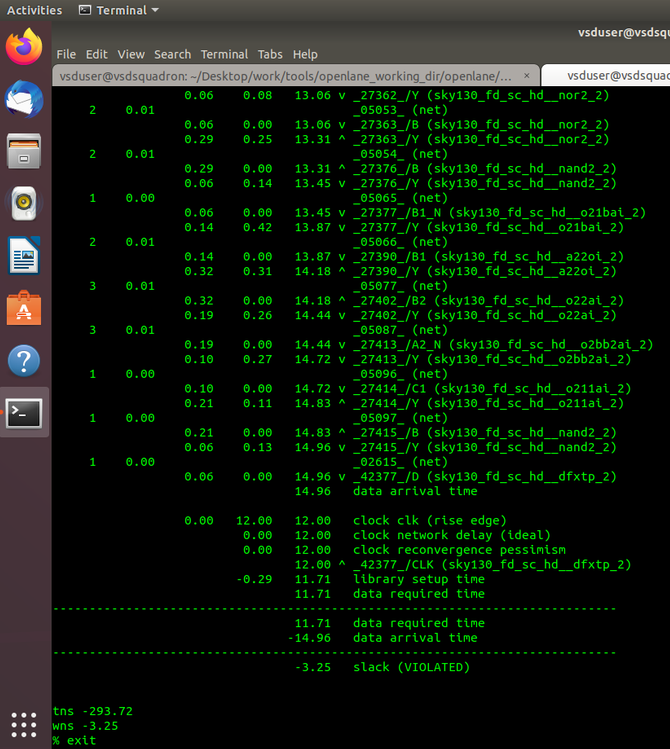

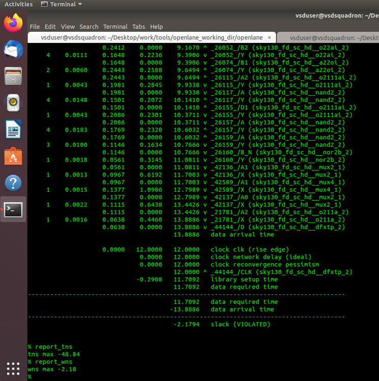

---

## 9. Interpreting timing results

Timing reports help identify the paths that limit performance or violate constraints. A useful review checks:

1. Which startpoint and endpoint are involved?
2. Is the path a setup (maximum-delay) or hold (minimum-delay) check?
3. Which clock launches and captures the data?
4. What are the cell and net delay contributions?
5. What slack is reported, and under which timing corner and constraints?
6. Does the path need changes to logic, cell sizing, buffering, placement, clock distribution, or routing?

Two common summary metrics are **Worst Negative Slack (WNS)** and **Total Negative Slack (TNS)**. WNS describes the worst slack among the paths considered, while TNS accumulates negative slack across violating paths. These metrics should only be reported numerically when the actual timing output is available and its analysis context is known.

---

## 10. Main takeaways

- Standard-cell delay depends on electrical conditions such as input slew and output load.
- Setup and hold checks impose different timing requirements and both must pass.
- Ideal-clock analysis simplifies clock behavior; an implemented clock tree introduces insertion delay and skew.
- CTS distributes the clock using buffers and a physical routing network.
- Clock topology, buffering, and shielding influence signal quality and implementation.
- Placement and interconnect parasitics affect data-path and clock-path timing.
- STA evaluates timing constraints and identifies paths that need attention.
- Timing closure is iterative: results from implementation and STA guide further optimization.

## Session completion checklist

- [ ] Reviewed the supplied cell-delay and buffering illustrations.
- [ ] Studied setup timing.
- [ ] Studied hold timing.
- [ ] Compared ideal and real clock models.
- [ ] Reviewed CTS, H-tree distribution, clock buffers, and shielding.
- [ ] Examined floorplan and placement screenshots.
- [ ] Studied clock skew and post-CTS timing effects.
- [ ] Reviewed STA terminal screenshots and the meaning of timing slack.

---

**Image organization:** all supplied screenshots are stored in `images/` and linked above using relative Markdown paths. Keep the directory name `images` unchanged when uploading this folder to GitHub.
