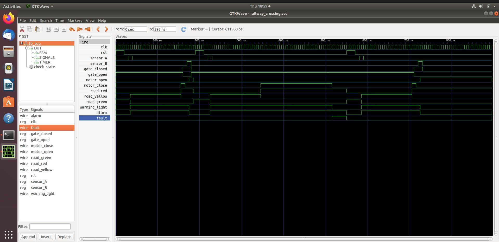
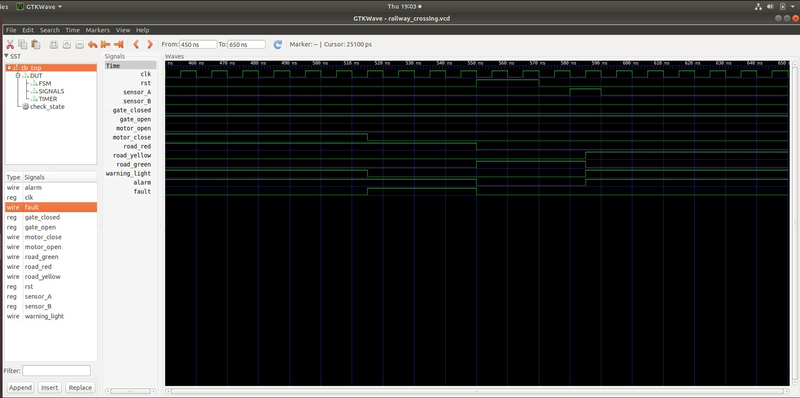
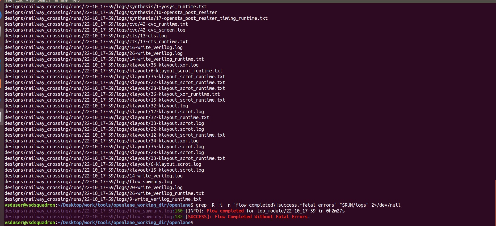
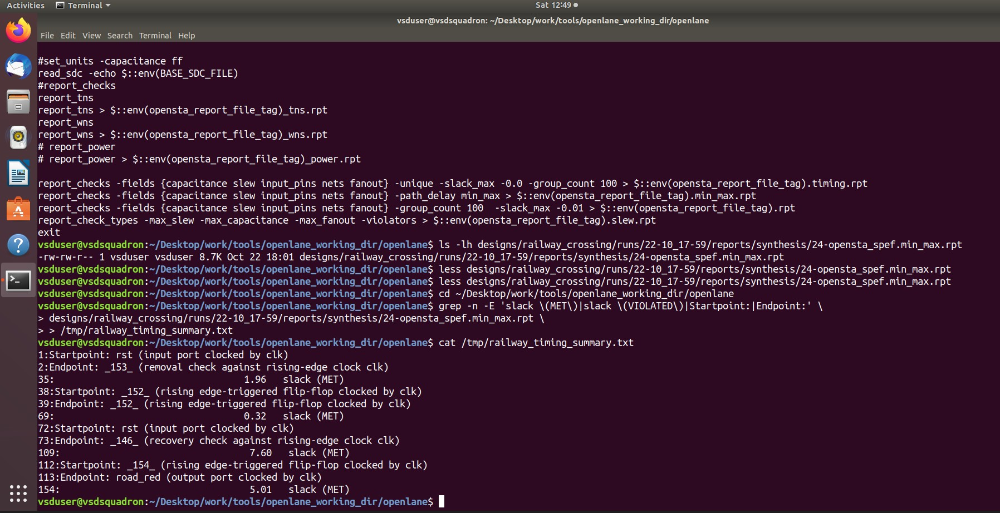
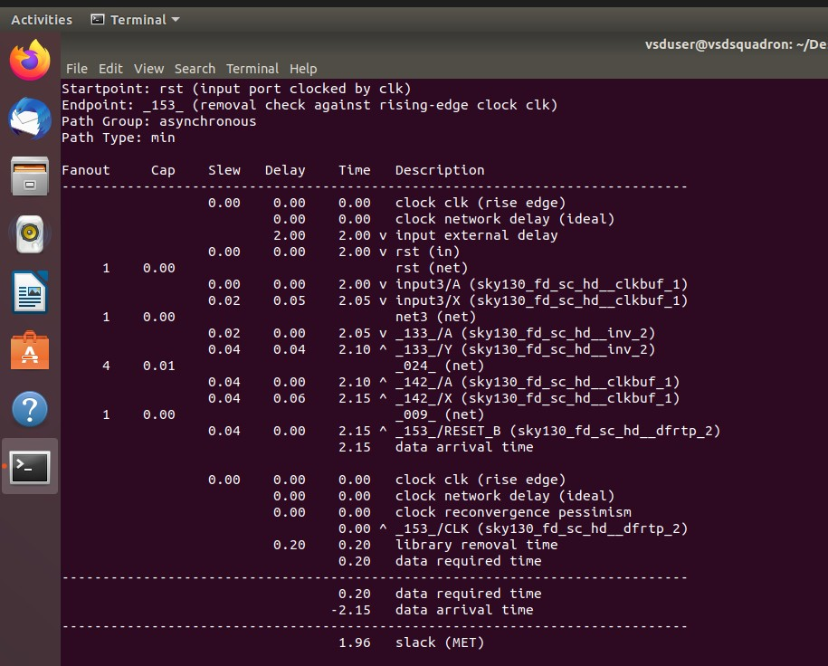
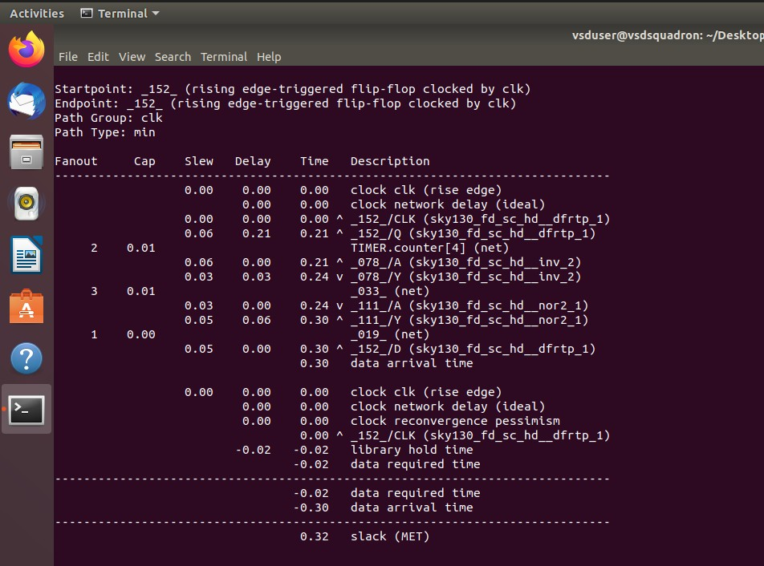
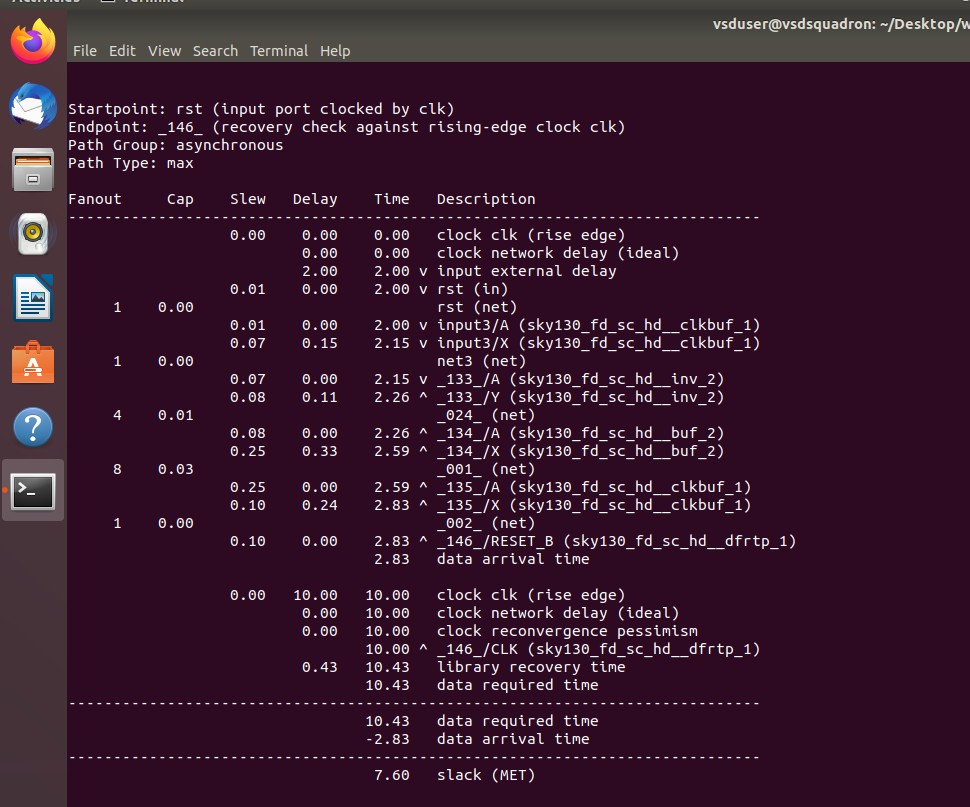
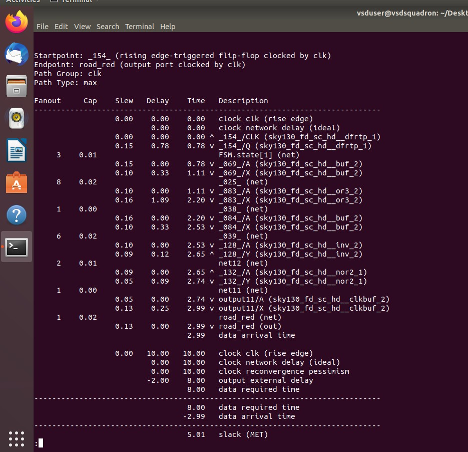
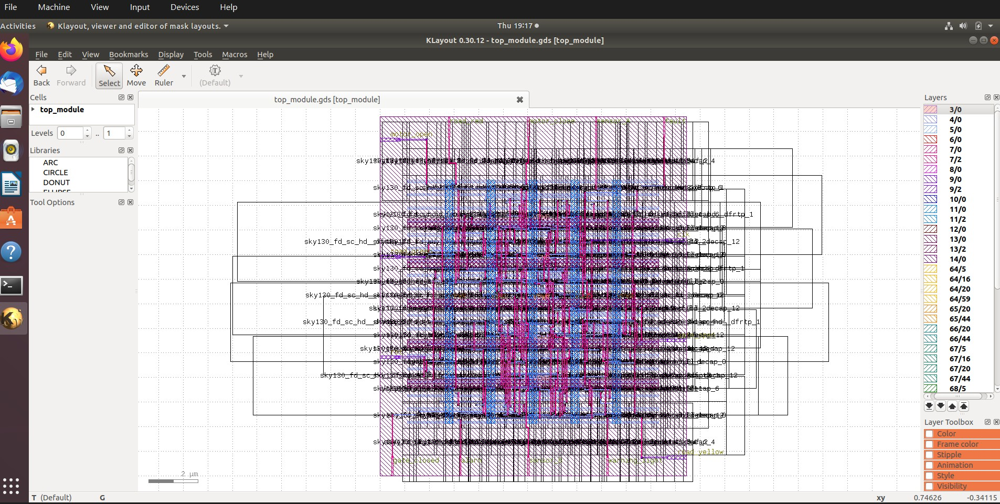

# Hybrid Fault-Aware Railway Level Crossing Controller

### Modular Verilog RTL Design | Functional Verification | RTL-to-GDSII Implementation

**Finite-State Control • Timeout Supervision • Fault Recovery • ASIC Physical Design**

---

## 1. Project Overview

This project implements a railway level-crossing controller in Verilog
HDL. A finite-state machine (FSM) coordinates train-detection inputs,
warning indicators, road traffic signals, gate motor commands, and
gate-position feedback.

The design includes timeout-based detection of unsuccessful gate
operations, fault indication, alarm outputs, and reset-based recovery.
Its RTL is organized into modules for state sequencing, signal control,
timer functionality, and top-level integration.

The design was simulated using Icarus Verilog, inspected in GTKWave, and
processed through the OpenLane RTL-to-GDSII flow targeting the SkyWater
SKY130A standard-cell platform.

> **Scope:** This is an educational digital-design project, not a
> certified railway safety system and not intended for deployment in
> operational railway infrastructure.

## 2. Objectives

-   Design a modular RTL controller for an automated level crossing.
-   Implement the normal crossing sequence using an FSM.
-   Coordinate warning indicators, road signals, and gate commands.
-   Use gate-position feedback to control sequence progression.
-   Detect gate-closing and gate-opening timeout conditions.
-   Exercise fault persistence and reset-based recovery.
-   Verify normal and abnormal scenarios in a testbench.
-   Inspect signal transitions using GTKWave.
-   Run an RTL-to-GDSII physical-design flow and inspect the layout.

## 3. System Architecture

``` text
              +---------------------------+
              |      Train Sensors        |
              |  sensor_A / sensor_B      |
              +-------------+-------------+
                            |
                            v
              +---------------------------+
              |        top_module         |
              |                           |
              |  +---------------------+  |
              |  | Railway FSM         |  |
              |  +----------+----------+  |
              |             |             |
              |  +----------v----------+  |
              |  | Signal Controller   |  |
              |  +---------------------+  |
              |  +---------------------+  |
              |  | Timer / Timeout     |  |
              |  +---------------------+  |
              +-------------+-------------+
                            |
             +--------------+---------------+
             |              |               |
             v              v               v
        Road Signals   Gate Commands   Warning / Fault
         Red/Yellow/    Open/Close      Alarm / Status
            Green
```

  -----------------------------------------------------------------------
  Module                              Responsibility
  ----------------------------------- -----------------------------------
  `top_module.v`                      Integrates modules and exposes the
                                      external interface.

  `railway_fsm.v`                     Governs state transitions and
                                      crossing progression.

  `signal_controller.v`               Implements road-signal and
                                      warning-output behavior.

  `timer.v`                           Provides timing functionality used
                                      by the controller.

  `tb_top.v`                          Applies test stimulus and checks
                                      expected behavior.
  -----------------------------------------------------------------------

## 4. Finite-State Machine

The controller uses six states:

  ------------------------------------------------------------------------
                      Encoding State                 Function
  ---------------------------- --------------------- ---------------------
                           `0` `IDLE`                Wait for train
                                                     detection.

                           `1` `WARNING`             Initiate the crossing
                                                     warning sequence.

                           `2` `CLOSE_GATE`          Command gate closure
                                                     and monitor feedback.

                           `3` `TRAIN_PASSING`       Maintain the
                                                     protected crossing
                                                     sequence during train
                                                     passage.

                           `4` `OPEN_GATE`           Command gate opening
                                                     and monitor feedback.

                           `5` `FAULT`               Indicate a fault and
                                                     remain faulted until
                                                     reset.
  ------------------------------------------------------------------------

### Nominal progression

``` text
IDLE -> WARNING -> CLOSE_GATE -> TRAIN_PASSING -> OPEN_GATE -> IDLE
```

### Fault transitions

``` text
CLOSE_GATE -- closing timeout --+
                                +--> FAULT -- reset --> IDLE
OPEN_GATE  -- opening timeout --+
```

The fault-handling logic addresses missing gate-closed or gate-open
feedback within configured timeout intervals. The testbench exercises
fault assertion, persistence, and reset-based clearing. These checks do
not constitute a complete functional-safety assessment.

## 5. Interface Specification

### Inputs

  Signal          Description
  --------------- --------------------------------
  `clk`           System clock.
  `rst`           Reset input.
  `sensor_A`      Train-detection input A.
  `sensor_B`      Train-detection input B.
  `gate_closed`   Gate-closed position feedback.
  `gate_open`     Gate-open position feedback.

### Outputs

  Signal            Description
  ----------------- ---------------------------------
  `motor_open`      Gate-opening command.
  `motor_close`     Gate-closing command.
  `road_red`        Red road traffic indication.
  `road_yellow`     Yellow road traffic indication.
  `road_green`      Green road traffic indication.
  `warning_light`   Crossing warning indicator.
  `alarm`           Fault alarm output.
  `fault`           Fault-status output.

Motor outputs are logical commands, not direct electrical drive
capability. A physical implementation would require actuator drivers,
interlocks, feedback conditioning, and independent safety mechanisms.

## 6. Repository Structure

``` text
Railway-Crossing-Controller/
├── README.md
├── config.tcl
├── src/
│   ├── railway_fsm.v
│   ├── signal_controller.v
│   ├── timer.v
│   └── top_module.v
├── tb/
│   └── tb_top.v
├── results/
│   └── final_summary_report.csv
└── images/
    ├── simulation-pass.jpg
    ├── waveform-crossing.jpg
    ├── waveform-fault.jpg
    ├── openlane-success.jpg
    ├── physical-design-summary.jpg
    └── final-layout.jpg
```

## 7. Functional Verification

RTL simulation was performed using **Icarus Verilog**. The testbench
applies nominal operating conditions and selected fault scenarios. A VCD
waveform was inspected in GTKWave.

  Scenario                   Expected behavior                   Recorded result
  -------------------------- ----------------------------------- -----------------
  Initial reset              Enter `IDLE`.                       PASS
  Train detection            Enter `WARNING`.                    PASS
  Warning completion         Begin gate-closing sequence.        PASS
  Gate-closed feedback       Begin train-passing sequence.       PASS
  Train-passage completion   Begin gate-opening sequence.        PASS
  Gate-open feedback         Return to `IDLE`.                   PASS
  Closing timeout            Enter `FAULT`.                      PASS
  Fault indication           Fault and alarm assert.             PASS
  Fault persistence          Fault remains latched.              PASS
  Reset recovery             Clear fault and return to `IDLE`.   PASS
  Opening timeout            Enter `FAULT`.                      PASS

The table summarizes the scenarios reported by the testbench.
Verification coverage is limited to the implemented checks and applied
stimulus.

### Simulation evidence


*Figure 1 --- Testbench output for nominal operation, timeout detection,
fault persistence, and reset recovery.*

## 8. Waveform Analysis

GTKWave was used to inspect the clock, reset, train sensors, gate
feedback, motor commands, road signals, warning output, alarm, and fault
status.

### Full crossing sequence



*Figure 2 --- Full simulation timeline showing controller signals during
the exercised scenarios.*

### Timeout and fault response



*Figure 3 --- Zoomed waveform around the gate-closing timeout event and
associated fault-related output transitions.*

Waveform inspection complements the testbench output by showing signal
transitions and their timing. The captured fault window focuses on the
fault event; reset recovery is also covered by the testbench results.

## 9. RTL-to-GDSII Physical Design

The design was processed using **OpenLane v0.21**, targeting the
SkyWater SKY130A platform and `sky130_fd_sc_hd` standard-cell library.

### Flow overview

``` text
Verilog RTL
    |
    v
Synthesis
    |
    v
Floorplanning
    |
    v
Placement
    |
    v
Clock Tree Synthesis
    |
    v
Routing
    |
    v
Physical Verification
    |
    v
GDSII Generation
```

This is a high-level representation of the physical-design workflow; the
exact checks and operations are determined by the configured flow.

### Configuration

  Parameter                        Configured value
  -------------------------------- -------------------
  OpenLane version                 `0.21`
  Process platform                 SkyWater SKY130A
  Standard-cell library            `sky130_fd_sc_hd`
  Top-level module                 `top_module`
  Clock period                     `10 ns`
  Corresponding target frequency   `100 MHz`
  Target core utilization          `30%`
  Target placement density         `0.40`

The configured clock frequency is a target, not proof of timing closure.
Timing should be evaluated using the relevant final timing reports and
constraints.

### OpenLane completion evidence



*Figure 4 --- OpenLane terminal showing the successful completion
message.*

## 10. Static Timing Analysis (STA)

The OpenLane run completed successfully. The screenshots below capture timing paths from the configured fast-minimum / slow-maximum STA analysis.

| Check | Reported slack | Status |
|---|---:|---|
| Reset removal | +1.96 ns | MET |
| Register-to-register hold | +0.32 ns | MET |
| Reset recovery | +7.60 ns | MET |
| `road_red` output path | +5.01 ns | MET |

### Timing evidence

**Timing summary**



**Reset removal path**



**Register-to-register hold path**



**Reset recovery path**



**`road_red` output timing path**



## 11. Physical-Design Results

The saved manufacturability report records these results for the
inspected run:

  Check                     Reported result
  ----------------------- -----------------
  Magic DRC violations                    0
  LVS total errors                        0
  Antenna pins violated                   0
  Antenna nets violated                   0

-   **DRC:** The report records zero Magic design-rule violations.
-   **LVS:** The report records zero total errors and no net, device,
    pin, or property mismatches.
-   **Antenna checks:** The report records zero antenna pin and net
    violations.

These results describe the checks in the saved report; they do not
establish complete safety, compliance with every foundry requirement, or
railway certification.

### Physical verification evidence


*Figure 5 --- Manufacturability report showing Magic DRC, LVS, and
antenna results.*

### Final GDSII layout



*Figure 6 --- Generated `top_module.gds` opened in KLayout for physical
inspection.*

The image demonstrates that the GDSII artifact was opened and inspected.
Numerical verification results are documented separately.

### Verification caveat

The run's CVC screen log contained a lock-file warning indicating that
`/cvc/.cvc.log` could not be created because the report file might be in
use. Although the overall OpenLane run reported successful completion,
this warning is disclosed rather than treating the CVC log as clean.

The saved summary report is available at
`results/final_summary_report.csv`.

## 12. Tools and Technologies

  Tool / technology   Role
  ------------------- ------------------------------------
  Verilog HDL         RTL design description.
  Icarus Verilog      RTL compilation and simulation.
  VVP                 Executes the compiled simulation.
  GTKWave             VCD waveform inspection.
  OpenLane v0.21      RTL-to-GDSII physical-design flow.
  SkyWater SKY130A    Target process platform.
  `sky130_fd_sc_hd`   Standard-cell library.
  KLayout             GDSII visualization.
  Linux / Ubuntu      Development environment.
  GitHub              Source control and documentation.

## 13. Reproducing the Simulation

Run these commands from the project root in a Linux environment with
Icarus Verilog installed.

### Compile

``` bash
iverilog -g2012 -o /tmp/railway_sim.out src/*.v tb/tb_top.v
```

### Execute

``` bash
vvp /tmp/railway_sim.out
```

Review the testbench messages for the outcome of each scenario.

### Inspect the waveform

The original simulation generated `railway_crossing.vcd`. If the VCD is
generated in the current directory, open it with:

``` bash
gtkwave railway_crossing.vcd
```

If the file is written elsewhere, use its actual path.

### Reproducing physical design

Reproducing the original physical-design run requires a compatible
OpenLane v0.21 environment, SKY130A platform and standard-cell library,
the design configuration, and the helper-tool setup used by the original
environment. The committed CSV is a report from the original run;
copying it into the repository does not rerun the flow.

## 14. Limitations and Future Work

Potential extensions include:

-   Add assertions for illegal FSM states and invalid transitions.
-   Expand testing for simultaneous sensor events and unexpected
    gate-feedback combinations.
-   Exercise reset behavior under additional timing conditions.
-   Review and document final setup and hold timing margins.
-   Automate regression simulation and result collection.
-   Document exact environment and helper-tool versions for reproducible
    physical design.
-   Improve layout visualization with selected layers and readable
    annotations.
-   Perform additional independent verification and hardware-level
    validation.

### Safety considerations

An operational railway crossing requires a defined fail-safe
architecture, independent safety mechanisms, sensor and actuator
diagnostics, fault analysis, appropriate interlocking, and compliance
with applicable railway safety standards. These requirements have not
been demonstrated by this educational project.

## 15. Conclusion

This project demonstrates a modular FSM-based railway level-crossing
controller with gate-operation timeout detection, fault latching, alarm
outputs, and reset-based recovery.

The RTL was exercised using Icarus Verilog, signal behavior was
inspected in GTKWave, and the design was processed through OpenLane
targeting SkyWater SKY130A. The saved physical-design report records
zero Magic DRC violations, zero LVS errors, and zero antenna violations
for the checks shown.

By combining modular RTL development, scenario-based simulation,
waveform analysis, and physical-layout inspection, the project
demonstrates an end-to-end digital-design workflow from behavioral
description to GDSII artifact generation.

**Project classification:** Educational FSM-based digital controller
with fault-handling logic and ASIC physical-design implementation.
